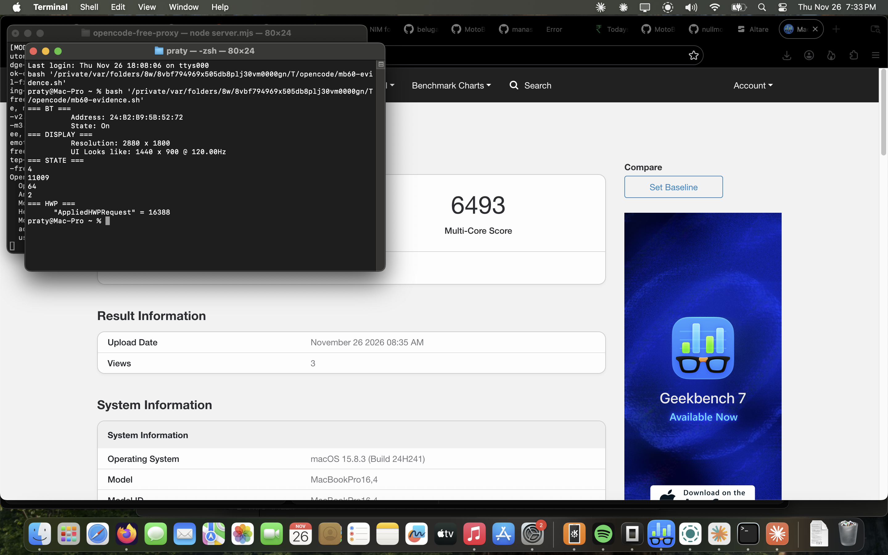

# Motorola Moto Book 60 (Core 7 240H) on macOS Sequoia 15.8.3

**Working OpenCore EFI for macOS 15.8.3 (24H241). The display, input, Wi‑Fi, Bluetooth and speakers work. The best recorded Geekbench 7 score is 1517 single / 8026 multi with the optional full bundle.**

> **SKU warning:** Moto Book 60 ships in several builds with different CPUs and panels. This EFI is only for the tested `83J7` with Core 7 240H, iGPU `8086:A7AB`, Samsung 2880×1800 OLED, Wi‑Fi `10EC:8922` and Bluetooth `0BDA:D922`. Other variants need their own custom EFI — do not overlay this one.

## Other Moto Book 60 builds

Moto Book 60 ships with different CPUs and displays. This repository is **only** for the tested Core 7 240H / `83J7` / Samsung 2880×1800 OLED configuration.

For any other variant, generate a custom EFI:

1. On Windows, run [nullmoth/1401](https://github.com/nullmoth/1401) as administrator.
2. Click **Check this PC** so it scans your exact CPU, GPU, Wi‑Fi, Bluetooth, panel and USB layout.
3. Click **Build the Mac setup**, read the BIOS steps, then **Create the macOS stick**.
4. Boot the 1401 stick and verify macOS starts before adding any extra patches.

Do not copy this Core 7 240H `BOOT/` + `OC/` onto another build. Use 1401's generated config as the base for that machine, then add only hardware-specific fixes you have verified.

Automated 1401 path (Windows, administrator PowerShell):

```powershell
powershell -ExecutionPolicy Bypass -File tools\generate-custom-efi.ps1 `
  -AppDir "C:\path\to\1401\engine\app" `
  -WorkDir ".\mb60-custom"
```

It scans this PC, builds a custom EFI with 1401's rules, and validates it. It does not erase or write a disk.

**Display caveat:** 1401's generated EFI will not contain this repository's custom WhateverXe build, panel timing patches, or 120 Hz raster work. It will not have this machine's Metal 2 / AUX brightness setup unless you add a compatible display kext yourself. The EFI in this repository includes those patches and is only for the tested Core 7 240H panel. For another build, verify display acceleration and brightness separately; do not assume the 1401 baseline provides them.



## Hardware

| Component | Details |
|---|---|
| Laptop | Motorola Moto Book 60, machine type `83J7` |
| CPU | Intel Core 7 240H, Raptor Lake, 6 P-cores + 4 E-cores, 16 threads with HT |
| GPU | Intel `8086:A7AB`, Samsung OLED 2880×1800 at 120 Hz |
| Wi‑Fi | Realtek RTL8922AE, PCI `10EC:8922` |
| Bluetooth | Realtek RTL8922A, USB `0BDA:D922` |
| Ethernet | RTL8152 USB adapter via built-in ECM |
| Audio | AppleALC layout 15; internal DMIC via custom driver |
| SMBIOS | `MacPro7,1` in the published profile |

## What works

- Native 2880×1800 at 120 Hz, plus a 60 Hz menu option and AUX brightness.
- Metal 2 acceleration, brightness keys, keyboard and trackpad (VoodooI2C polling).
- Realtek Wi‑Fi and Bluetooth, stable after reboot.
- Speakers, USB, battery/sensors.
- Optional full bundle: custom EPP/HWP tuning, fan mode, DYTC performance profile, internal mic driver.

**Not working / not verified:** internal mic on the published `MacPro7,1` profile (use a laptop SMBIOS if mic matters); AirDrop with a real Apple device; system sleep/wake.

## EFI configuration

- OpenCore 1.0.8, macOS 15.8.3 (24H241).
- SMBIOS `MacPro7,1`, board-id `Mac-A61BADE1FDAD7B05`.
- SIP `csr-active-config = 03 08 00 00`, SecureBootModel disabled.
- Published config is sanitized; generate your own serial, MLB, UUID and ROM.

### Boot arguments

```text
keepsyms=1 -allow3d -disablegfxfirmware -igfxdvmt -wex-tgl-edp-keep -wex-panel-gop -wex-edp-auxbl -btlfxboardid -btlfxallowanyaddr -btlfxrealtek ctrsmt=off hcpower=4,2 -vi2c-force-polling hpmpl1=64 tccoffset=2 revpatch=memtab,pci
```

### Key hashes

```text
d0163dfbe5d2ea46aececd7d7349acfa5b75dfed2993e8489816f3dda71914c8  BOOTx64.efi
9ef21f9d846a992c030fa5858736a6d9efa70a3b4ad88b8d747338bb457b14d4  OpenCore.efi
343ee1c60ae170235a1e7085a144f4724219e7c6c3314396441f3a4361151199  config.plist
fb2f6bb995f951acb5df501892ae1281c54e5062dffcd0599ad4121496b07546  WhateverXe
```

## Kexts

The `OC/Kexts` folder contains the boot/driver kexts: Lilu, RestrictEvents, CpuTscSync, WhateverXe, BrightnessKeys, BlueToolFixup, BTNameFix, AirPort_RTW89, IO80211FamilyLegacy, IOSkywalkFamily, RTL8922AFirmware, AppleALC, USBToolBox + UTBDefault, XHCI-unsupported, VirtualSMC, SMCBatteryManager, ReYogaSMC, VoodooPS2Controller, VoodooI2C, VoodooI2CHID, AMFIPass. CPUFriend and CpuTopologyRebuild are present but disabled.

The custom EPP, FanMode, RaplDiag, TccOffset and mic kexts are in `full/` and are installed into the auxiliary kernel collection, not the EFI.

## Installation

1. Back up the disk and ESP; keep a separate bootable recovery USB.
2. Format a USB stick as GPT/FAT32 with an EFI partition.
3. Prepare the USB with the included script:
   ```bash
   ./tools/prepare-usb.sh --confirm-matching-hardware /Volumes/USB-EFI
   ```
   It copies `BOOT/` and `OC/`, generates a fresh identity into `identity.generated.json`, applies it to `config.plist`, and runs `ocvalidate` if available.
4. Boot from USB with the firmware picker. Verify display, brightness, keyboard/trackpad, Wi‑Fi, Bluetooth and audio.
5. Optional performance bundle, only after a clean boot:
   ```bash
   sudo ./tools/install-full.sh --yes
   ```
   It installs `full/`, rebuilds AuxKC, and prints when to reboot. It does not unload kexts.
6. Copy verified `BOOT/` and `OC/` to the internal ESP, preserving other boot entries. Keep the recovery USB.

## Display

WhateverXe is a custom 0.8.2-derived build with native 120 Hz raster for this Samsung OLED panel. The EDID reports only 60 Hz; the 120 Hz mode comes from WhateverXe timing. AUX brightness failures measured 0. Lighter scaled modes work; 3840×2400 render caused glitches and is not recommended.

## Bluetooth and Wi‑Fi

Realtek Bluetooth needs BlueToolFixup with Realtek patches plus `-btlfxboardid -btlfxallowanyaddr -btlfxrealtek`. Wi‑Fi uses the legacy 80211 stack + AirPort_RTW89 + Skywalk family + AMFIPass. Ethernet via RTL8152 binds built-in `AppleUSBECMData` through a high probe score in the firmware kext.

## CPU and limits

`IntelHybridCores` (`ctrsmt=off hcpower=4,2`), `HybridPM` (`hpmpl1=64`), and the custom EPP kext (EPP 0, HWP Desired 0) are used. `CPUFriend` and `CpuTopologyRebuild` are disabled. The logged `ICCMAX/PL4/OTHER` limit remains active; do not raise VRM/current limits or override thermal protections to chase a score. Best score with the full bundle and maximum fan cooling: Geekbench 7 `1517 / 8026`.

## Internal microphone

On the published `MacPro7,1` profile the mic publisher fails with `0xe00002d5` (initial PM idle acknowledgement missing). Use a laptop SMBIOS if the mic matters. The driver is included in `full/` for reference.

## Resources

- [Dortania OpenCore Install Guide](https://dortania.github.io/OpenCore-Install-Guide/)
- [OpenCorePkg](https://github.com/acidanthera/OpenCorePkg)
- [WhateverXe](https://github.com/b00t0x/WhateverXe)
- [IntelHybridCores](https://github.com/rodgod-rr/IntelHybridCores)
- [HybridPM](https://github.com/Thatisjigen/HybridPM)
- [IntelSpeedShiftEPP](https://github.com/xnpty/IntelSpeedShiftEPP)

## Credits

Upstream OpenCore, Lilu, VirtualSMC, WhateverXe, VoodooI2C, VoodooPS2, AppleALC, IntelHybridCores, HybridPM and IntelSpeedShiftEPP projects. This EFI is machine-specific; it is not a universal macOS configuration.
